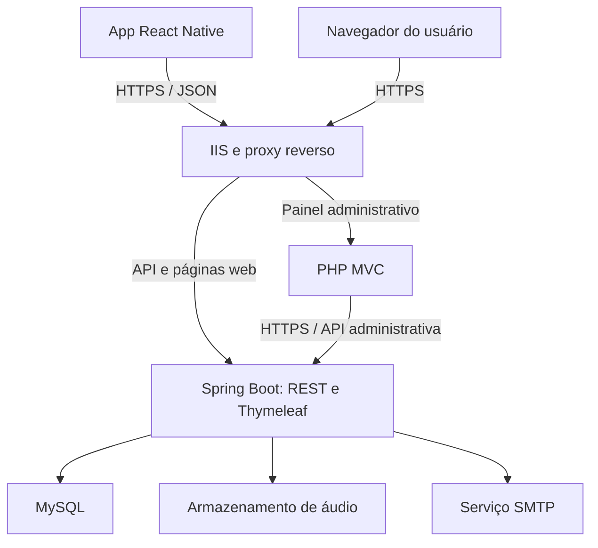

# Sistema de Streaming de Música

Plataforma acadêmica de streaming com catálogo musical, playlists e reprodução online no navegador e no celular. O aplicativo mobile também permitirá ouvir faixas previamente baixadas, com controle de acesso offline e sincronização quando a conexão retornar.

A solução será desenvolvida por uma equipe de nove integrantes e organizada em um monorepositório: **API e cliente web em Java Spring Boot**, **painel administrativo em PHP** e **aplicativo em React Native**. A API Java centralizará as regras de negócio, a autorização e o acesso ao banco de dados.

**Repositório:** [KusKusDosKlan/streaming_de_musica](https://github.com/KusKusDosKlan/streaming_de_musica)

> **Status:** desenvolvimento inicial. O repositório contém a estrutura dos módulos, configurações, uma migration SQL e arquivos-base. Os principais fluxos ainda precisam ser implementados e testados. As funcionalidades descritas neste README representam o escopo planejado, salvo quando identificadas como existentes.

## Sumário

- [Objetivo e escopo](#objetivo-e-escopo)
- [Arquitetura](#arquitetura)
- [Tecnologias](#tecnologias)
- [Organização do código](#organização-do-código)
- [Dados e contratos da API](#dados-e-contratos-da-api)
- [Streaming, downloads e sincronização](#streaming-downloads-e-sincronização)
- [Ambiente de desenvolvimento](#ambiente-de-desenvolvimento)
- [Plano de implementação](#plano-de-implementação)
- [Equipe e colaboração](#equipe-e-colaboração)
- [Testes e critérios de entrega](#testes-e-critérios-de-entrega)
- [Publicação e continuidade](#publicação-e-continuidade)
- [Segurança, licenças e decisões pendentes](#segurança-licenças-e-decisões-pendentes)
- [Documentação](#documentação)

## Objetivo e escopo

O projeto busca oferecer uma experiência de biblioteca musical integrada: o administrador publica o catálogo, o usuário encontra e reproduz músicas, e o aplicativo mantém os downloads autorizados disponíveis mesmo sem conexão.

| Frente | Funcionalidades planejadas |
| --- | --- |
| Conta do usuário | Cadastro, login, confirmação de e-mail, recuperação de senha e papéis `USER` e `ADMIN`. |
| Catálogo | Artistas, álbuns, faixas, busca e listagens paginadas. |
| Biblioteca pessoal | Criação e edição de playlists, organização de faixas e histórico de reprodução. |
| Cliente web | Páginas Thymeleaf, autenticação por sessão e player no navegador. |
| Aplicativo mobile | Catálogo, player online, reprodução em segundo plano, downloads protegidos e reprodução offline. |
| Administração | Gestão de catálogo e usuários, upload de áudio e relatórios básicos, sempre por meio da API. |
| Operação | HTTPS, serviços do Windows, monitoramento, logs, backups e publicação de versões aprovadas. |

O primeiro ambiente de publicação previsto no documento técnico é um servidor físico com **Windows Server 2019**. A expansão para **Microsoft Azure** começará pelo backup externo; contingência e hospedagem na nuvem serão etapas posteriores, conforme as decisões da equipe.

Planos pagos e o papel `PREMIUM` estão fora da entrega inicial até que seu escopo seja aprovado.

## Arquitetura

A API Java será a **única fonte de verdade**. O painel PHP consumirá endpoints administrativos e não terá credenciais nem conexão direta com o MySQL. Os clientes mobile e web usarão as mesmas regras de catálogo, acesso e playlists.



O diagrama representa a implantação planejada. O app será instalado no dispositivo; o servidor executará a API, o cliente web e o painel administrativo.

### Responsabilidades dos módulos

- **Java:** autenticação, autorização, validações, catálogo, playlists, streaming, upload definitivo, licenças offline, sincronização e envio de e-mails.
- **PHP:** sessão do administrador, formulários e telas de gestão, chamadas HTTP à API e apresentação dos resultados. A API repetirá as validações necessárias antes de persistir qualquer alteração.
- **React Native:** interface do usuário, consumo da API, player, gerenciamento de downloads e dados locais, armazenamento seguro e fila de sincronização.
- **Infraestrutura:** rede, certificados, IIS, serviços, permissões, observabilidade, backups e recuperação.

### Fluxo de uma música

1. O administrador envia o áudio e os metadados pelo painel PHP.
2. O PHP encaminha a solicitação autenticada à API Java.
3. A API valida o arquivo e a permissão, grava o áudio no armazenamento protegido e salva seus metadados no MySQL.
4. Os clientes consultam o catálogo e pedem a reprodução à API.
5. A API verifica o acesso e entrega os trechos de áudio solicitados pelo player.

## Tecnologias

| Camada | Base atual ou tecnologia planejada |
| --- | --- |
| Backend | Java 17, Maven e Spring Boot **3.5.16**, conforme o `pom.xml` atual. |
| Web e persistência | Spring MVC, Thymeleaf, Spring Data JPA, Bean Validation, MySQL 8.x e Flyway. |
| Segurança e operação | Spring Security, BCrypt, JWT a implementar, Spring Mail e Actuator. |
| Painel administrativo | PHP **8.2+**, Composer, arquitetura MVC e Guzzle. |
| Mobile | React Native **0.87.0**, React **19.2.0**, TypeScript e Axios, conforme o `package.json` atual. |
| Dados locais e player | Banco local, biblioteca de áudio e integração com armazenamento seguro ainda serão selecionados e validados. |
| Servidor | Windows Server 2019, IIS, FastCGI, ARR/URL Rewrite e serviço para execução do JAR. |
| Continuidade | Backup local e externo; Microsoft Azure como expansão planejada. |

As versões acima descrevem os manifests existentes, não uma certificação de compatibilidade de todo o sistema. Atualizações e bibliotecas nativas deverão ser avaliadas em PRs próprios, com os testes dos módulos afetados.

## Organização do código

| Caminho | Responsabilidade |
| --- | --- |
| [`api-java-backend/`](api-java-backend/) | API REST, aplicação web, persistência, segurança, e-mail e migrations. |
| [`admin-panel-php/`](admin-panel-php/) | Painel administrativo e integração HTTP com a API. |
| [`mobile-app-reactnative/`](mobile-app-reactnative/) | Aplicativo, telas, player, downloads e sincronização. |
| [`docs/`](docs/) | Documentação de colaboração e limites entre repositório e servidor. |
| `.github/` | Modelos de Issues e Pull Requests; workflows poderão ser adicionados durante a implantação da CI. |

### Backend Java

O pacote existente é `com.IEGP3.streamingApp`; o nome definitivo do produto e do pacote ainda será definido.

| Pasta ou camada | Como será usada |
| --- | --- |
| `controller/rest/` | Receber requisições JSON do app e expor os contratos REST. |
| `controller/web/` | Atender o navegador e renderizar páginas Thymeleaf. |
| `controller/admin/` | Expor operações administrativas protegidas. |
| `dto/` | Definir os dados de entrada e saída, sem expor entidades JPA diretamente. |
| `service/` | Aplicar regras de negócio, autorização sobre recursos e coordenação das operações. |
| `repository/` e `model/` | Consultar e representar os dados persistidos com JPA. |
| `security/` e `config/` | Configurar tokens, sessões, permissões e integrações. |
| `util/StorageService` | Controlar o acesso aos arquivos de áudio. |
| `resources/db/migration/` | Versionar o banco com Flyway. |
| `resources/templates/` e `static/` | Manter páginas, templates de e-mail e recursos do cliente web. |

O fluxo REST seguirá **requisição → controller/DTO → service → repository → banco**. Streaming e upload também usarão o serviço de armazenamento. O tratamento centralizado de erros será acrescentado durante a implementação.

### Painel e aplicativo

O PHP está organizado em `app/controllers/`, `app/models/`, `app/views/` e `app/core/`, com entrada em `public/index.php`. Os models serão clientes da API, e não modelos de acesso ao banco. O `ApiClient` já possui a base de uma chamada GET; as operações de escrita, upload e tratamento de erros ainda serão desenvolvidas.

O mobile separa `src/api/`, `screens/`, `components/`, `navigation/`, `store/`, `services/`, `database/`, `hooks/` e `utils/`. Essa divisão permite desenvolver a interface sem misturar o player, o acesso físico aos arquivos e a sincronização.

## Dados e contratos da API

A migration inicial [`V1__create_tables.sql`](api-java-backend/src/main/resources/db/migration/V1__create_tables.sql) contém as tabelas `roles`, `users`, `artists`, `albums`, `tracks`, `playlists`, `playlist_tracks`, `downloads`, `play_history` e `verification_tokens`.

O banco armazenará metadados e relacionamentos. Os binários de áudio ficarão em uma pasta protegida, identificados por caminhos controlados pelo servidor. Uma playlist pertencerá a um usuário e se relacionará com várias faixas por meio de `playlist_tracks`.

As entidades atuais ainda precisam receber os campos e relacionamentos completos. Alterações no schema deverão entrar em **novas migrations**; migrations já compartilhadas ou aplicadas não serão reescritas.

### Principais endpoints planejados

Prefixo: **`/api/v1`**. A tabela resume o contrato de referência; os métodos ainda não estão implementados nos controllers atuais.

| Grupo | Método e rota | Finalidade |
| --- | --- | --- |
| Conta | `POST /auth/register`, `/auth/login` e `/auth/refresh` | Cadastro, autenticação e renovação de acesso. |
| E-mail | `POST /auth/verify-email`, `/auth/forgot-password` e `/auth/reset-password` | Verificação e recuperação de conta. |
| Catálogo | `GET /tracks?search=&page=&size=` e `GET /tracks/{id}` | Busca, paginação e detalhes de faixas. |
| Artistas e álbuns | `GET /artists/{id}` e `GET /albums/{id}` | Consulta de detalhes e relacionamentos. |
| Reprodução | `GET /tracks/{id}/stream` | Entrega de áudio com HTTP Range. |
| Playlists | `GET/POST /playlists`, `PUT/DELETE /playlists/{id}` | Gestão das playlists do usuário. |
| Faixas da playlist | `POST /playlists/{id}/tracks` e `DELETE /playlists/{id}/tracks/{trackId}` | Adição e remoção de faixas. |
| Offline | `POST /tracks/{id}/download-token` e `GET /tracks/{id}/download` | Autorização e download protegido. |
| Sincronização | `POST /sync` | Envio de alterações locais e recebimento de mudanças do servidor. |
| Administração | `POST /admin/tracks` e `PUT /admin/tracks/{id}` | Upload e atualização de faixas. |
| Administração | `GET /admin/users` e `GET /admin/reports/usage` | Gestão de usuários e relatório de uso. |

Os contratos detalhados definirão payloads, paginação, erros, datas em UTC e validações. A API REST usará tokens; o cliente web usará sessão. Rotas de autenticação terão regras próprias, e um token de download não substituirá indiscriminadamente o token de acesso.

As operações administrativas exigirão `ADMIN`. Alterações em playlists serão autorizadas pela propriedade do recurso, e não apenas pelo papel do usuário.

## Streaming, downloads e sincronização

### Reprodução online

A API entregará o áudio sem carregar o arquivo inteiro na memória. O player poderá solicitar intervalos de bytes para avançar e retroceder:

- `200`: entrega completa quando não houver `Range`.
- `206`: intervalo válido, com `Content-Range` e tamanho do trecho.
- `416`: intervalo inválido, com o tamanho disponível informado conforme o protocolo.
- `404`: faixa ou arquivo inexistente.
- `401/403`: acesso ausente ou não autorizado.

### Reprodução offline

1. O app solicitará autorização de download à API.
2. A API verificará o acesso e retornará um token temporário e a validade da licença offline.
3. O app baixará e verificará o arquivo, armazenando-o de forma protegida, com chave mantida no armazenamento seguro do sistema.
4. Metadados, validade e disponibilidade offline serão registrados no banco local.
5. O player reproduzirá a faixa baixada sem buscar o arquivo na rede.
6. Ao reconectar, o app revalidará o acesso e tratará licenças expiradas ou revogadas.

A integração entre player, criptografia e armazenamento nativo será validada em uma prova de conceito antes da implementação completa. A proteção local não será apresentada como DRM inviolável.

**Offline é uma funcionalidade do app:** músicas já baixadas poderão tocar sem conexão, mas login remoto, novos downloads e atualização do catálogo dependerão do servidor. Uma revogação feita enquanto o aparelho estiver desconectado só poderá ser conhecida ao reconectar; a validade local limitará o acesso nesse intervalo.

### Sincronização

Alterações em playlists e registros de reprodução offline serão guardados em uma fila persistente. Ao reconectar, o app enviará os eventos para `/sync` e receberá alterações, mapeamentos entre IDs locais e IDs do servidor e downloads revogados.

Antes de desenvolver esse fluxo, a equipe definirá identificadores únicos de evento, política de conflito, ordem de processamento e reenvio. **Repetir uma requisição não poderá duplicar seus efeitos.** O relógio do dispositivo não será a única referência para ordenar mudanças.

## Ambiente de desenvolvimento

### Estado atual

| Parte existente | Limite atual |
| --- | --- |
| Configuração Spring, Flyway e Actuator | A configuração de segurança permite `/actuator/health` e bloqueia as demais rotas. |
| Controllers, services, DTOs e entidades | São arquivos-base; os fluxos de negócio e mapeamentos completos ainda estão pendentes. |
| Entrada do painel e cliente Guzzle | O painel mostra uma página inicial; autenticação, roteamento MVC e CRUD ainda serão conectados. |
| Telas e serviços mobile | Player, downloads, criptografia e banco local estão pendentes. Os projetos nativos `android/` e `ios/` ainda não existem nessa estrutura. |
| Modelos de Issue e PR | Já estão presentes em `.github/`; a automação de CI ainda será acrescentada. |

### Preparação

Instale Git, um JDK compatível com o backend, Maven, MySQL 8.x, PHP 8.2+ e Composer. Para mobile, use Node.js e o ambiente Android compatíveis com a versão aprovada do React Native. A compilação iOS exigirá macOS e Xcode.

```bash
git clone https://github.com/KusKusDosKlan/streaming_de_musica.git
cd streaming_de_musica
```

### Backend

Crie o banco vazio `streaming_app` e uma conta local de desenvolvimento. Configure as variáveis no terminal ou na IDE usando [`api-java-backend/.env.example`](api-java-backend/.env.example) como referência.

```bash
cd api-java-backend
mvn spring-boot:run
```

O projeto atual não inclui Maven Wrapper; esse comando exige Maven instalado e disponível no `PATH`. O Spring não está configurado para carregar automaticamente um arquivo `.env`.

O endereço local padrão é `http://localhost:8080`; o health-check é `http://localhost:8080/actuator/health`. O Flyway aplicará a migration ao iniciar, e o Hibernate está configurado para validar o schema. A inicialização e o health-check não comprovam que login ou player já funcionam.

### Painel PHP

Em outro terminal, na raiz do repositório:

```bash
cd admin-panel-php
composer install
php -S 127.0.0.1:8000 -t public
```

Acesse `http://127.0.0.1:8000` para visualizar a página inicial. O servidor embutido do PHP é apenas para desenvolvimento. Para integrar chamadas, configure `STREAMING_API_BASE_URL` e `STREAMING_ADMIN_API_TOKEN` no ambiente do processo PHP; a validação desse token na API ainda será implementada.

### Mobile

Gere a base nativa com a versão de React Native aprovada pela equipe em uma pasta temporária e integre `android/`, `ios/` e as configurações ao módulo existente, preservando `src/` e `App.tsx`. Somente depois configure as dependências e execute o app no emulador ou aparelho.

O cliente atual contém a URL de desenvolvimento em [`src/api/apiClient.ts`](mobile-app-reactnative/src/api/apiClient.ts). O `.env.example` documenta a intenção de configuração, mas ainda não há integração automática dessa variável. Em aparelho físico, `localhost` aponta para o próprio celular; use um endereço do computador que o dispositivo consiga alcançar.

### Configuração por ambiente

| Variáveis | Uso |
| --- | --- |
| `DB_URL`, `DB_USERNAME`, `DB_PASSWORD` | Conexão MySQL da API. |
| `STORAGE_AUDIO_DIR` | Caminho dos arquivos de áudio. |
| `JWT_SECRET` | Segredo da futura implementação JWT. |
| `MAIL_HOST`, `MAIL_PORT`, `MAIL_USERNAME`, `MAIL_PASSWORD` | Serviço de e-mail. |
| `MAIL_SMTP_AUTH`, `MAIL_SMTP_STARTTLS` | Configuração SMTP do ambiente local. |
| `APP_PUBLIC_BASE_URL`, `SERVER_PORT`, `SPRING_PROFILES_ACTIVE` | Endereço público, porta e perfil de execução. |
| `STREAMING_API_BASE_URL`, `STREAMING_ADMIN_API_TOKEN` | Integração do painel com a API. |

HTTP é usado pelos arquivos atuais para desenvolvimento local. A publicação prevista exige HTTPS, inclusive na comunicação PHP–API; certificados e a conexão interna segura precisarão ser configurados. Não reutilize os padrões locais em produção.

## Plano de implementação

A equipe trabalhará em entregas pequenas e integradas. Primeiro será implementado um fluxo completo — autenticar, consultar uma faixa e reproduzi-la — antes de ampliar o catálogo e o offline.

| Etapa | Desenvolvimento | Entrega verificável |
| --- | --- | --- |
| 1. Fundação | Completar entidades, DTOs, migrations e contratos; implementar cadastro, login e autorização. | Fluxos de conta testados; usuário comum não acessa operações administrativas. |
| 2. Streaming | Serviço de arquivos, HTTP Range e players web/mobile online. | Uma faixa autorizada toca e permite avançar/retroceder; respostas `206` e `416` testadas. |
| 3. Administração | Login administrativo, catálogo e upload via API. | Uma faixa cadastrada pelo painel aparece no catálogo e pode ser reproduzida. |
| 4. Offline | Prova de conceito do player protegido, downloads, banco local, licenças e sincronização. | Faixa toca após reiniciar o app em modo avião; reenvio não duplica eventos. |
| 5. Infraestrutura | Ambiente de teste, serviços do Windows, IIS, HTTPS e backup automatizado com cópia externa. | Acesso de outro dispositivo, recuperação após reboot e restauração demonstrados. |
| 6. Consolidação | Busca, playlists, histórico, relatórios, testes integrados e revisão da experiência. | Critérios de entrega aprovados e release identificada por tag. |

Playlists e histórico terão seus contratos definidos cedo, pois também serão utilizados pela sincronização. A etapa final consolida esses recursos; não adia todas as suas dependências para o fim.

## Equipe e colaboração

Divisão prevista no documento técnico:

| Squad | Integrantes | Responsabilidade |
| --- | ---: | --- |
| Backend Java | 4 | API, cliente web, dados, autenticação, e-mail, streaming, sincronização e testes. |
| Mobile React Native | 2 | Interface, consumo da API, player, downloads e persistência local. |
| Painel PHP | 2 | Sessão administrativa, telas, formulários e integração com os endpoints admin. |
| Infraestrutura | 1 | Servidor físico, rede, publicação, monitoramento, backups e expansão cloud. |

Cada squad terá um ponto de contato para integração e documentação. Um segundo integrante deverá acompanhar os procedimentos de publicação e recuperação para que a operação não dependa de uma única pessoa.

### Fluxo de trabalho no GitHub

1. Registre a tarefa em uma [Issue](https://github.com/KusKusDosKlan/streaming_de_musica/issues), com responsável, objetivo, dependências e critérios de aceite.
2. Organize as tarefas em um Project com estados **A fazer → Em andamento → Em revisão → Concluído**. Use Milestones para agrupar as entregas do roadmap.
3. Crie uma branch curta a partir de `develop`, como `feature/backend-streaming-range` ou `fix/mobile-player`.
4. Faça commits pequenos, revise o diff e abra um [Pull Request](https://github.com/KusKusDosKlan/streaming_de_musica/pulls) para `develop`.
5. Peça revisão a outra pessoa e registre como validar a alteração. No mesmo repositório, use `Closes #NUMERO` para associar a tarefa; o fechamento automático ocorre ao integrar na branch padrão, não necessariamente no primeiro merge em `develop`.
6. Após os testes integrados, abra o PR de release de `develop` para `main` e identifique a versão aprovada com uma tag.

`main` representará versões aprovadas; `develop`, a integração. O fluxo da equipe exige PR e ao menos uma aprovação para ambas. As regras de proteção deverão ser configuradas e conferidas na Organization; sua existência não é comprovada apenas por este README.

Use Conventional Commits (`feat:`, `fix:`, `docs:`, `test:`). Alterações em contratos, migrations ou configurações compartilhadas devem indicar os impactos nas outras squads.

## Testes e critérios de entrega

| Área | Validações necessárias |
| --- | --- |
| Backend | Testes unitários de regras com JUnit/Mockito e integração com banco de teste. |
| Autenticação | Login inválido, token expirado, recuperação de senha, verificação de e-mail e tentativa de acesso administrativo por `USER`. |
| Propriedade de recursos | Um usuário não pode alterar a playlist de outro. |
| Streaming | Intervalos válidos e inválidos, início/fim do arquivo, seek, arquivo removido e autorização antes da entrega. |
| Painel | Upload válido/inválido, falha de API, sessão administrativa e ausência de acesso direto ao banco. |
| Mobile | Aparelho real, modo avião, reinício, segundo plano, falta de espaço e download interrompido. |
| Sincronização | Reenvio do mesmo evento, conflito e interrupção de rede sem duplicação. |
| Operação | HTTPS, reinício dos serviços, firewall, restauração de banco e áudio e procedimento de retorno de versão. |

Comandos existentes para a base atual:

```bash
# Dentro de api-java-backend/
mvn verify

# Dentro de admin-panel-php/
composer check

# Dentro de mobile-app-reactnative/, após instalar as dependências
npm run typecheck
```

O teste Java atual é de carregamento do contexto; não constitui cobertura dos requisitos. `composer check` verifica a sintaxe de `public/index.php`, e `typecheck` verifica tipos, sem validar reprodução ou offline. A cobertura será ampliada conforme os fluxos forem implementados.

Uma entrega será considerada pronta quando seus critérios estiverem demonstrados, o PR estiver revisado, a documentação estiver atualizada e as verificações relevantes passarem. CI será acrescentada para automatizar os checks; falhas não deverão ser ignoradas para integrar uma alteração.

## Publicação e continuidade

No ambiente planejado, o IIS receberá o tráfego HTTPS e encaminhará `/api/*` e as páginas do usuário ao Spring Boot; `/admin/*` atenderá o painel PHP. Os endpoints administrativos da API permanecerão sob `/api/v1/admin/*`, separados do caminho público do painel.

O Java será distribuído como JAR de uma versão aprovada e executado como serviço do Windows. MySQL e portas internas não serão publicados diretamente na internet. A pasta de áudio ficará fora da raiz pública, com permissões limitadas à conta do serviço.

| GitHub | Ambiente operacional |
| --- | --- |
| Código, migrations, testes, documentação e exemplos sem segredos. | JAR aprovado, painel publicado, banco, áudio, certificados e configuração efetiva. |
| Histórico, PRs e tags. | Logs, backups e dados reais protegidos. |

A publicação seguirá: **versão aprovada → build → backup → ambiente de teste → validação → ambiente estável**. Migrations e alterações de dados terão planejamento próprio de recuperação; reverter o código não reverte automaticamente o banco.

A primeira entrega de continuidade será um backup consistente do banco e dos arquivos, com cópia externa criptografada e restauração testada em ambiente separado. A contingência em Azure dependerá de orçamento, procedimentos e metas de recuperação definidos. Dois servidores gravando em bancos independentes não serão usados como solução de disponibilidade.

## Segurança, licenças e decisões pendentes

- Senhas serão protegidas com BCrypt. Tokens de e-mail terão expiração e uso único; access e refresh tokens terão política de renovação e revogação.
- A sessão web terá cookies seguros e proteção CSRF. Permissões e propriedade de recursos serão verificadas no servidor.
- Tokens administrativos ficarão no processo PHP, nunca no HTML ou JavaScript entregue ao navegador.
- Uploads terão limites de tamanho, validação do conteúdo e nome definido pelo servidor. Caminhos fornecidos pelo cliente não serão usados livremente.
- Segredos, certificados, dados pessoais, áudio, backups e logs não serão commitados. Exemplos de ambiente permanecerão sem credenciais reais.
- Serão usadas apenas músicas próprias ou com autorização de reprodução e distribuição compatível com o projeto.

Decisões que precisam ser registradas antes da implementação correspondente:

| Decisão | Impacto |
| --- | --- |
| Biblioteca de player e armazenamento local | Compatibilidade com React Native, execução em segundo plano, reprodução de conteúdo protegido e licença de uso. |
| Validade da licença offline | Prazo de reprodução sem conexão e tratamento de expiração/revogação. |
| Identificador e conflitos da sincronização | Idempotência, ordenação, reenvio e conciliação de mudanças. |
| Autenticação administrativa PHP–API | Identidade do administrador, credencial de serviço, auditoria e rotação de tokens. |
| Escopo cloud | Backup externo, contingência ou hospedagem ativa, com custo e recuperação definidos. |
| Nome e licença do projeto | Identificação do produto e condições de uso do código. |

O repositório ainda não possui arquivo `LICENSE`. A equipe deverá definir a licença do código e verificar as licenças das dependências antes da distribuição. Direitos sobre o código e direitos sobre o catálogo musical são tratados separadamente.

## Documentação

- [Backend Java](api-java-backend/README.md)
- [Painel administrativo PHP](admin-panel-php/README.md)
- [Aplicativo React Native](mobile-app-reactnative/README.md)
- [Fluxo da equipe](docs/FLUXO-DE-EQUIPE.md)
- [GitHub e servidor: responsabilidades e arquivos](docs/GITHUB-VS-SERVIDOR.md)

**Referência de requisitos:** *Requisitos Técnicos — Sistema de Streaming de Música*, versão consolidada de 10/10/2026. O guia de equipe em `docs/FLUXO-DE-EQUIPE.md` ainda apresenta a divisão anterior de squads; sua atualização deverá acompanhar a divisão de nove integrantes descrita neste README.

**Base de código consultada:** branch `main`, [commit `8ebf78d`](https://github.com/KusKusDosKlan/streaming_de_musica/tree/8ebf78df2476090340dbff4e7932696bcdcb8755), em 12/10/2026.
